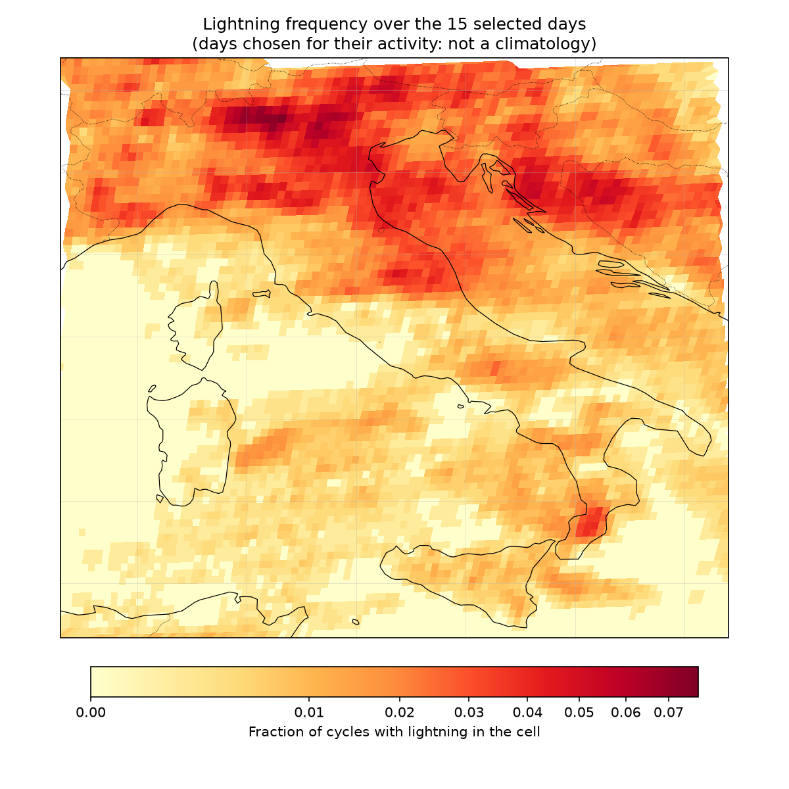
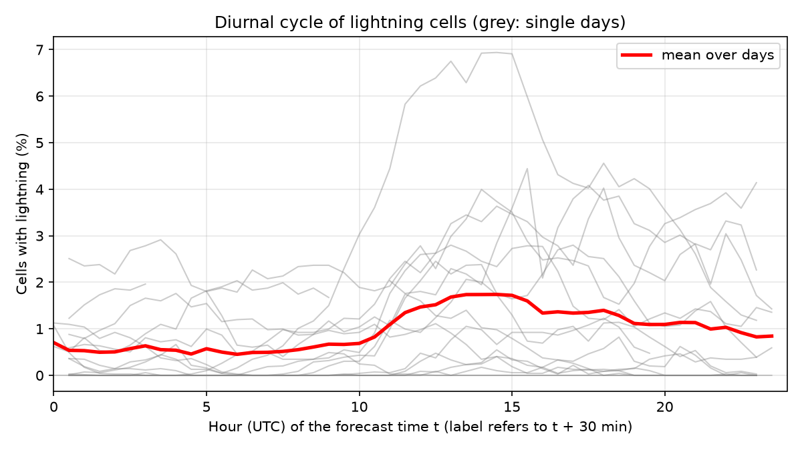
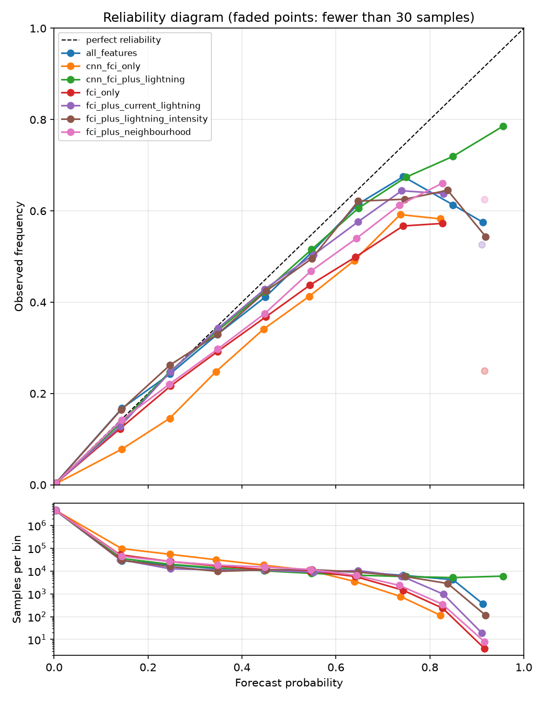
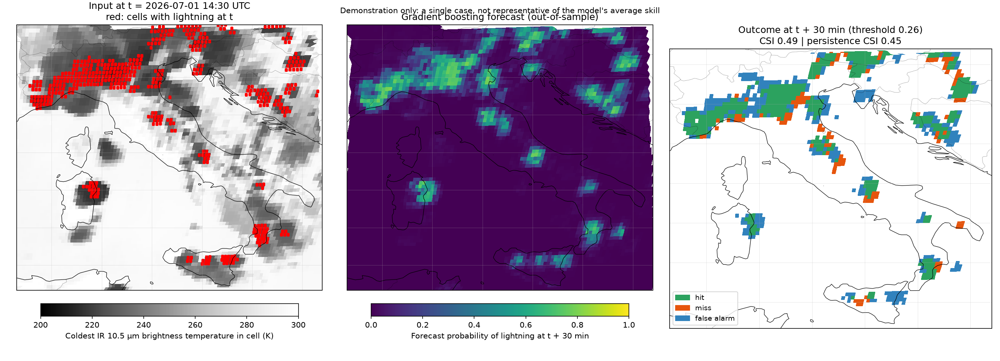

# mtg-convection-ml

Short-term (30 min) lightning occurrence nowcasting over Italy, built from **MTG-I1 FCI** (Flexible Combined
Imager) and **MTG-I1 LI** (Lightning Imager) data distributed by EUMETSAT.

> **This is a demonstration project.**
> It was built to show hands-on experience with EUMETSAT / MTG data and with an end-to-end ML workflow
> (data access, preprocessing, labelling, model training, verification). It is **not** an operational or
> scientifically validated lightning nowcasting system, and its results must not be used for any
> forecasting purpose. See [Disclaimers](#disclaimers).

## What it does

For every cell of a coarse grid (5 × 5 native 2 km pixels, about 10 km) over Italy, the models estimate whether
at least one lightning flash will be observed in that cell **30 minutes later** (lead time of 3 repeat cycles of 10 min).

```
EUMDAC download ──> preprocessing ──> labels/features ──> gradient boosting ─┐
 (FCI chunks + LI)   (common 2 km grid)  (per-cell table)                    ├─> verification vs persistence
                          └──────────────> CNN (native-resolution fields) ───┘     (POD, FAR, CSI, Brier, ...)
```

- **Data:** FCI L1c (`EO:EUM:DAT:0662`, channels IR 10.5 µm and WV 6.3 µm) and LI L2 accumulated flashes
  (`EO:EUM:DAT:0686`). Only the FCI chunks covering the region (6.6°E–18.8°E, 36.5°N–47.1°N) are downloaded.
- **Preprocessing:** the LI grid is the FCI 2 km grid flipped vertically, so no resampling is needed: the two
  products are aligned and cropped over Italy, one NetCDF per 10-min cycle.
- **Label:** a cell is positive if its accumulated flashes at *t + 30 min* are ≥ 1.
- **Tabular model:** `HistGradientBoostingClassifier` on per-cell features (IR mean/min, WV mean, IR–WV
  brightness temperature difference, 30-min IR cooling, optionally lightning at the forecast time and in the
  3×3 neighbourhood).
- **CNN:** small fully convolutional network on native-resolution fields (IR, WV, their change over the last
  30 min, optionally LI), one logit per coarse cell.
- **Baseline:** *persistence*, i.e. "a cell has lightning at t + 30 min if it has lightning at t".

## Reproducing the results

### 1. Requirements

- Python 3.12 (the version the project was developed on) and an environment able to install `satpy`,
  `netCDF4`, `h5py` and `cartopy`. Using conda is the easiest route.
- A free EUMETSAT Data Store account with API credentials (consumer key and secret):
  <https://api.eumetsat.int/api-key/>.
- Enough disk space for the raw data of the selected days; the download is the slowest step.
- Optional: a GPU (CUDA or Apple MPS) for the CNN. It falls back to the CPU, only more slowly.

### 2. Installation

```bash
git clone https://github.com/giuliabernardi1/mtg-convection-ml.git
cd mtg-convection-ml

conda create -n mtg-convection python=3.12 -y
conda activate mtg-convection
pip install -r requirements.txt
pip install -r requirements_dev.txt   # optional: pytest, notebooks
```

Create a `.env` file in the project root:

```
CONSUMER_KEY_EUMETSAT=<your key>
CONSUMER_SECRET_EUMETSAT=<your secret>
```

If you need to set a proxy you can do it in this file by adding:

```
HTTP_PROXY=<your proxy>
HTTPS_PROXY=<your proxy>
REQUESTS_CA_BUNDLE=<path to your certificates>
SSL_CERT_FILE=<path to your certificates>
SSL_CERT_VERIFY=<path to your certificates>
```

### 3. Configuration

All parameters live in [`config.yaml`](config.yaml): region, paths, days to download, cell size, lead time,
label threshold, model hyperparameters, feature sets, CNN settings. To use another file, set
`MTG_CONFIG=/path/to/other.yaml`.

### 4. Run the pipeline

Run the scripts from the project root, in this order:

| Step | Command | Output |
|---|---|---|
| 1. Download FCI chunks and LI products for the configured days | `python download_data_main.py` | `data/raw_chunks/` |
| 2. Align FCI and LI on the 2 km grid, crop over Italy | `python preprocessing_main.py` | `data/processed/*.nc` |
| 3. Build the per-cell feature/label table | `python labels_main.py` | `data/samples.parquet` |
| 4. Train and evaluate the gradient boosting models | `python train_main.py` | `results/<feature_set>.csv`, `results/<feature_set>_reliability.csv` |
| 5. Train and evaluate the CNN | `python cnn_main.py` | `results/cnn_*.csv`, `results/cnn_*_reliability.csv` |
| 6. Plot reliability diagrams, maps and diurnal cycle | `python plot_main.py` | `results/reliability.png`, `results/map_*.png`, `results/diurnal_cycle.png` |

Downloads and preprocessing are resumable: files that already exist are skipped, and partially downloaded
files are discarded.

Run the unit tests (synthetic data only, no credentials needed) with:

```bash
python -m pytest
```

Notes on reproducibility:

- The gradient boosting seed is set in `config.yaml` (`train.seed`). The CNN also uses a fixed seed, but
  results can still differ slightly between devices (CPU / CUDA / MPS) and library versions.
- Re-running with the same days and settings should give very similar, but not necessarily bit-identical, numbers.
- The `notebooks/` folder contains the exploratory analyses used to choose days and thresholds and to inspect the
  FCI/LI alignment. They are not needed to reproduce the results.

## Evaluation protocol

- **Data:** 10 days of July 2026 chosen to cover very active, moderately active and almost quiet days
  (1, 3, 9, 11, 13, 15, 24, 26, 30 and 31 July). The 10-min cycles of these days were used.
- **Split:** *leave-one-block-out*. Days separated by at most 2 days are grouped in one block (a "weather
  episode"), giving 4 blocks. Each block is used once as test set. In every fold, the smallest remaining block
  is held out as validation set to choose the probability threshold (maximum CSI); the others are used for
  training. Splitting is by day, never by cell or time, because neighbouring samples are strongly correlated.
- **Metrics:** POD, FAR and CSI (computed from counts pooled over the four test blocks), plus PR-AUC, ROC-AUC,
  Brier score and Brier skill score per block. Brier skill uses the base rate of the test block as
  reference. A reliability diagram is also produced.
- **Baseline:** persistence (lightning in the cell at the forecast time).
- **CNN probabilities** are recalibrated with Platt scaling fitted on the validation block. This only affects
  the probabilistic scores (Brier, reliability): the binary decisions, and therefore POD/FAR/CSI, are unchanged.

Lightning frequency in the selected days (fraction of cycles with lightning in each cell). The days were chosen
for their activity:



Diurnal cycle: percentage of cells with lightning by UTC hour (grey: single days, red: mean):



## Results

Pooled over the four test blocks. Thresholds were chosen on the validation block of each fold.

| Model | POD ↑ | FAR ↓ | CSI ↑ | Brier skill (min–max over blocks) ↑ |
|---|---|---|---|---|
| Persistence (baseline) | 0.492 | 0.505 | 0.328 | – |
| Gradient boosting, FCI only | 0.472 | 0.677 | 0.237 | 0.16 – 0.24 |
| + current lightning | 0.528 | 0.530 | 0.331 | 0.23 – 0.37 |
| + 3×3 neighbourhood (FCI only) | 0.555 | 0.642 | 0.278 | 0.21 – 0.30 |
| + lightning intensity (now, past) | 0.567 | 0.525 | 0.348 | 0.25 – 0.40 |
| Gradient boosting, all features | 0.595 | 0.521 | 0.361 | 0.27 – 0.43 |
| CNN, FCI only | 0.578 | 0.737 | 0.221 | 0.10 – 0.26 |
| CNN, FCI + lightning | **0.663** | **0.492** | **0.404** | 0.37 – 0.42 |

CSI by test block (model vs persistence):

| Test block | Days | Persistence | GB all features | CNN FCI + lightning |
|---|---|---|---|---|
| 0 | 1–3 Jul | 0.427 | 0.431 | 0.418 |
| 1 | 9–15 Jul | 0.335 | 0.373 | 0.412 |
| 2 | 18–26 Jul | 0.275 | 0.317 | 0.395 |
| 3 | 30–31 Jul | 0.351 | 0.398 | 0.385 |

Take-aways, to be read together with the disclaimers below:

- Models using **only satellite imagery (FCI)** do **not** beat persistence in this setup: they have a higher
  false alarm ratio and a lower CSI.
- Most of the skill comes from **knowing where lightning is already occurring** (LI). The gain over persistence
  is moderate: about +0.03 CSI for the gradient boosting model with all features and about +0.075 for the CNN with lightning input.
- The advantage over persistence is **not consistent across blocks**: in block 0 persistence is as good as the
  gradient boosting model and slightly better than the CNN, while in the other blocks the two models with lightning
  information are ahead (CNN by +0.03 to +0.12 CSI).
- After Platt scaling, the CNN with lightning input is well calibrated up to about 0.3 forecast probability and
  slightly over-forecasts above that (e.g. forecast 0.75 vs observed 0.67; forecast 0.96 vs observed 0.79). The FCI-only
  CNN remains clearly over-confident (forecast 0.35 vs observed 0.25). The gradient boosting model with all features is
  close to the diagonal up to about 0.7 and over-forecasts above; without lightning it is over-confident from about 0.25
  (see `results/reliability.png`, generated by step 6).
- ROC-AUC is very high for all models (about 0.95–0.997) because positive cells are rare (a few percent at most):
  it should not be used to rank models here. PR-AUC, CSI and Brier skill are more informative.

**Reliability diagrams** (forecast probability vs observed frequency for each model):



**Case study**: input IR 10.5 µm with current lightning, forecast probability and hit/miss/false alarm outcome at
t+30 min. It is a single out-of-sample example, not representative of the average skill.



All figures are generated by `python plot_main.py` (copies are kept in `docs/figures/`).

## Disclaimers

Please read the results as a **proof of workflow**, not as evidence of forecasting skill.

1. **Tiny, non-representative sample.** Only 10 days of a single month (July 2026) were used, selected on
   purpose for their lightning activity. Frequencies, thresholds and scores are therefore not representative
   of other seasons, regions or weather regimes, and the number of independent weather episodes (4) is very small.
2. **No uncertainty estimates.** No confidence intervals or significance tests were computed. Differences of a few
   hundredths in CSI between models are likely within sampling noise, given the strong variability between blocks.
3. **Hyperparameters not tuned.** Gradient boosting and CNN settings are fixed defaults; the architecture and
   training schedule (12 epochs) were not optimised. The label threshold (≥ 1 flash per cell) is provisional.
4. **Selection and evaluation share data.** The decision threshold is picked on a single, small validation block
   per fold, and the feature sets and number of days were compared by looking at the same test blocks, so the
   reported scores are somewhat optimistic. The Platt scaler is also fitted on that small block.
5. **Residual leakage is possible.** Splits are by block of days, which avoids leakage between consecutive
   cycles and neighbouring cells, but no explicit time buffer separates training, validation and test days.
6. **Persistence is a weak baseline.** It is a useful sanity check, but stronger baselines (advection of the
   lightning field with optical flow, hourly climatology) were not implemented. Outperforming persistence
   here does not imply outperforming operational nowcasting systems.
7. **Different time resolutions.** FCI is used every 30 min while LI is available every 10 min; LI flashes are
   accumulated over the cycles matching the FCI time window.
8. **Geolocation offset.** A small shift between cloud features and flashes was observed and not corrected.
9. **Cell-based verification.** Metrics are computed on coarse cells inside a bounding box (not on the exact
   Italian territory), pooling different locations and times. Cell-based verification ignores displacement
   errors and is not comparable to object- or neighbourhood-based verification.
10. **No quality control.** No filtering of FCI or LI products was done beyond dropping cells with missing FCI values.

## Possible next steps

- More days and seasons, bootstrap confidence intervals over days or blocks.
- Stronger baselines (optical-flow advection of lightning, hourly climatology).
- Several lead times (10, 30, 60, 90 min) and neighbourhood-based verification (e.g. Fractions Skill Score).
- Architectures with temporal context (U-Net, ConvLSTM) and hyperparameter tuning.
- Correcting the cloud/flash geolocation offset and using more FCI channels.

## Repository layout

```
config.yaml                 central configuration
download_data_main.py       step 1: download from the EUMETSAT Data Store
preprocessing_main.py       step 2: FCI + LI alignment and cropping
labels_main.py              step 3: per-cell features and labels
train_main.py               step 4: gradient boosting, leave-one-block-out
cnn_main.py                 step 5: CNN, leave-one-block-out
plot_main.py                step 6: reliability diagrams, maps, diurnal cycle
src/                        library code (download, chunks, preprocessing, labels, train, cnn, evaluation, config)
tests/                      unit tests on synthetic data
notebooks/                  exploratory analyses
resources/FCI_chunks.wkt    geometry of the FCI chunks, used to select the chunks covering Italy
results/                    metrics and plots produced by the scripts
```

## Data and credits

Contains data from EUMETSAT: MTG-I1 FCI Level 1c (`EO:EUM:DAT:0662`) and LI Level 2 Accumulated Flashes
(`EO:EUM:DAT:0686`), retrieved with the [EUMDAC](https://gitlab.eumetsat.int/eumetlab/data-services/eumdac) client.
Data are subject to the EUMETSAT data policy; this repository does not redistribute them.
Reading and resampling rely on [Satpy](https://satpy.readthedocs.io/).

## License

See [LICENSE](LICENSE).

